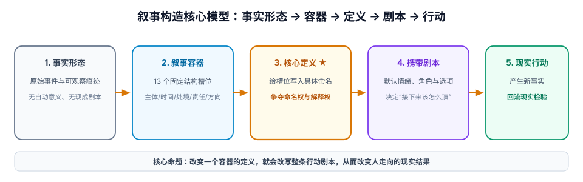

## 本章要解决的问题

前三章分别讨论了事实与定义的区别、命名权的分配、定义携带的剧本。每一个概念都指向一个核心活动——人如何构建对现实的理解。

现在需要正面回答这个问题：**叙事构造到底是什么？它和普通描述、讲故事、编造事实有什么区别？一个人在进行叙事构造时，实际在做什么？**



## 从一个具体场景开始

你和一位朋友最近一个月没怎么联系。你发了一条消息，对方两天后才回复，回复内容简短，没有解释为什么这么久才回。

现在你需要在心里"定义"这件事——因为你的情绪和下一步行动取决于这个定义。

你的大脑自动工作了。它搜索了过去的线索，考虑了各种可能性，最终产生了一个版本：

- "他可能对我有意见。"
- "他最近太忙了，顾不上回复。"
- "我们的关系变淡了。"
- "他是那种不怎么看消息的人。"

不管哪一个版本胜出，你都在进行同一个活动：**围绕一组事实对象（消息未回、延迟回复、内容简短），形成一个完整的理解，这个理解定义了你的朋友、你们的关系、对方的动机以及这件事意味着什么。**

这就是叙事构造。

## 旧有理解的问题

"叙事"在中文语境中常被理解为"讲故事"或"话语操纵"。这两种理解遗漏了关键一点：**叙事不是偶尔发生的文艺活动或宣传行为，而是人理解现实的基本操作方式。**

人在清醒的每一刻都在自动完成叙事构造——不是写小说，而是在大脑中持续运行：识别正在发生什么、推测为什么发生、预测接下来会怎样、决定如何反应。只有当两个人的叙事产生冲突时，这个底层操作才会浮出水面。

## 新方法的核心结构

叙事构造的完整定义：

> **叙事构造（Narrative Construction），是围绕核心对象，对现实中存在或发生的内容做出定义，并由这些定义形成对事件、主体与未来的完整理解。**

这个定义包含五个要素：

```
核心对象 → 定义 → 定义体系 → 完整理解 → 行动
```

**核心对象：** 叙事需要处理的是什么。在个人层面，可能是你的身份、一段关系、一次经历。在共同体层面，可能是一个社会事件、一个组织变革、一段历史。

**定义：** 对核心对象的具体命名、分类、定性。比如把"消息回复慢"定义为"关系变淡"。

**定义体系：** 单一的定义往往不够。一组相互关联的定义形成体系——对主体的定义、对行为的定义、对动机的定义、对意义的定义——共同构成对事件的整体理解。

**完整理解：** 定义体系的输出——"发生了什么"的最终版本。这个版本影响你的情绪、判断和行动。

**行动：** 叙事构造的终点不是理解，而是行动。无论是主动作为、保持沉默还是改变策略，行动由叙事构造的结果驱动。

## 关键概念与边界

**叙事构造 vs 编造事实：** 叙事构造基于事实对象。编造事实无视或伪造事实。两者的区分标准是是否接受事实检验。

**叙事构造 vs 普通描述：** 描述指向可感知的特征（"杯子是红色的"），叙事构造指向意义与行动框架（"这是一种挑衅"）。描述几乎没有剧本，叙事构造天然带有剧本。

**叙事构造 vs 讲故事：** 讲故事是有意识组织的叙事构造。叙事构造范围更广——你早上对"今天是哪种日子"的模糊判断也是叙事构造。

**单个定义 vs 完整叙事：** 一个定义处理一个对象。多个定义（主体+行为+结果+动机+意义）共同构成完整叙事。

**定义现实 vs 歪曲现实：** 好的叙事构造允许事实修正定义；歪曲现实的定义拒绝事实检验。

::: {.content-visible when-format="html"}
<div data-nc-toy="ch04-nc-vs-storytelling"></div>
:::

## 完整应用示例

**场景：** 一个团队项目失败了，客户不满意，公司损失了一个重要机会。

现在团队需要理解"发生了什么"。这不是一个学术问题——对这个问题的定义，将决定谁来负责、如何善后、以后怎么做事。

**主体定义：**

- 项目经理："团队缺乏经验"（团队是主体）
- 成员 A："项目经理没有明确需求"（项目经理是主体）
- 成员 B："客户反复改需求"（客户是主体）
- 公司高层："项目管理流程不够健全"（制度是主体）

**行为定义：**

- "项目经理指挥失误"
- "成员执行不力"
- "客户需求管理不到位"
- "流程设计有缺陷"

**动机定义：**

- "项目经理想赶工期"
- "市场部急于推出新功能"

注意：以下常见表达容易混入其他容器——"客户自己也没想清楚"属于原因或认知状态判断（不是动机）；"团队成员缺乏责任心"属于主体评价（不是动机）。容器分析的第一步就是避免这种混层。

**结果定义：**

- "一次失败"（结果）
- "一次交付延期"（结果）
- "客户满意度下降"（结果）
- "两名核心开发者离职"（结果）

注意："一次昂贵的教训"属于意义定义（代表什么），"一个改进步伐的起点"属于时间定义（什么阶段），"一个应当追责的事故"属于责任定义（谁负责）。它们不是结果本身，而是基于结果产生的判断。

**意义定义：**

- "这说明我们的流程需要优化"（意义——事件说明了什么）
- "这说明管理层对项目支持不足"（意义）
- "这说明我们的需求管理方式需要改进"（意义）

注意："我们的团队能力不够"属于原因判断（为什么失败），"我们的流程需要优化"属于方向判断（接下来怎么办），"不靠谱的客户以后不要接"属于主体评价+方向判断。它们不是严格的意义定义。

**完整的叙事构造产物：**

如果公司最终接受的定义体系是："一个缺乏经验的团队在没有清晰流程的情况下，接手了一个高复杂度项目，导致交付失败。"

这个叙事携带的剧本：
- 角色：团队是学习者，管理层是流程建设者
- 行为许可：复盘、培训、流程改进
- 发展路径：制度升级 → 能力提升 → 下次做得更好

如果公司最终接受的定义体系是："项目经理玩忽职守，团队成员缺乏责任心，导致公司损失。"

这个叙事携带的剧本：
- 角色：项目经理是责任人，团队是失职者
- 行为许可：追责、处罚、人事调整
- 发展路径：问责 → 换人 → 重建团队

两组定义都基于同一组事实对象。它们的差异不在于事实，而在于叙事构造的选择。

## 操作方法

面对一个需要理解的事件，按以下流程构建叙事：

**第一步：识别核心对象。**

这件事涉及哪些核心对象？主体是谁？发生了什么行为？产生了什么结果？原因是什么？意义是什么？

**第二步：列出已有定义。**

各方参与者各自使用了什么定义？你自己自动产生了什么定义？

**第三步：检查定义与事实的对应。**

每个定义对应哪些事实对象？有哪些事实没有被任何定义覆盖？有哪些定义缺乏事实支撑？

**第四步：评估各定义携带的剧本。**

每个定义分别预设了哪些角色、关系、行为许可和发展路径？

**第五步：构建自己的定义体系。**

选择或生成一组定义，使其：
- 覆盖关键事实
- 具有清晰边界
- 携带有利于判断和行动的剧本
- 允许未来修正

**第六步：转化为行动。**

根据你构建的叙事，你接下来应该做什么？

## 常见错误与修正规则

**错误一：把叙事构造等同于"换个说法"。**

叙事构造不是修辞练习。它的核心是更准确地理解现实。如果定义不准确，"更好的说法"只会造成更严重的判断失误。

**错误二：认为只有面对重大事件才需要叙事构造。**

叙事构造每时每刻都在发生——对一条消息的判断、对一次对话的理解、对一个陌生人的第一印象，都是叙事构造。

**错误三：把叙事构造等同于"共同认可一个版本"。**

不是所有的事情都需要统一叙事。理解竞争定义的存在，比追求一个"统一版本"更重要。

## 本章训练

回想今天发生的三件事（可以很小，比如一条消息、一次对话、一个决定）。

1. 对每件事，你自动产生的叙事定义是什么？
2. 每个定义对应什么样的事实对象？
3. 每个定义携带什么剧本？
4. 如果换一个定义，你的情绪和行动会如何不同？

## 本章产物

一份"叙事构造定义卡"，包含：

- 叙事构造的完整定义（用自己的话写一遍）
- 叙事构造与编造事实/普通描述/讲故事的区分要点
- 今日三件事的定义—剧本分析

::: {.content-visible when-format="html"}
<div data-nc-toy="ch04-nc-workflow"></div>
:::

