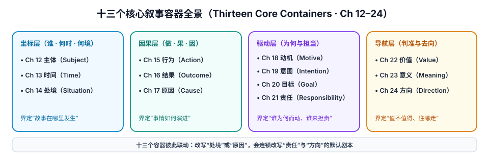

## 本章要解决的问题

第 6 章建立了容器、定义、剧本三者关系。但容器本身还没有被完整罗列和解释。对于一个刚开始学习叙事构造的人来说，最直接的困惑是：**到底有哪些容器？它们各自负责什么？它们之间是什么关系？**

本章给出全书的完整对象体系——十三个核心容器。这不是一个需要背诵的清单，而是一个在后续章节中会被反复使用的参照框架。



## 从一个具体场景开始

你收到一条消息，对方说："我们下周见个面吧，有些事想当面聊清楚。"

你的大脑收到这条消息后，需要完成一系列叙事构造工作：

- 对方是谁？—— 主体容器
- 现在是什么时机？—— 时间容器
- 这是好事还是坏事？—— 处境容器
- "聊清楚"是什么意思？—— 行为容器
- 见面后可能产生什么结果？—— 结果容器
- 对方为什么要这么做？—— 原因/动机容器
- 对方打算谈什么？—— 意图容器
- 对方希望达成什么？—— 目标容器
- 如果谈不拢，谁的问题？—— 责任容器
- 这件事是好的发展还是不好的？—— 价值容器
- 这件事对我们的关系意味着什么？—— 意义容器
- 我接下来应该怎么回应？—— 方向容器

这一系列问题几乎在瞬间完成。但如果你能意识到每个问题的存在，你就在从"自动叙事"过渡到"主动叙事构造"。

## 十三个容器的完整清单

十三个容器的分组与结构如下：

### 事件基本骨架

这五个容器构成了理解一个事件需要的最基础信息：

**主体（Subject）：** 谁？这个主体被理解成谁？ **时间（Time）：** 什么时候？现在属于什么阶段？ **处境（Situation）：** 什么局面？主体处于什么条件中？ **行为（Action）：** 做了什么？这一行为算是什么？ **结果（Outcome）：** 什么后果？产生了什么状态变化？

这五个容器的叙事顺序通常是：某个主体，在某个时间，处于某个处境，做了某些行为，产生了某些结果。

### 行动解释对象

这四个容器解释了行为背后的驱动结构：

**原因（Cause）：** 为什么会发生？导致结果的条件是什么？ **动机（Motive）：** 什么内部力量推动主体行动？ **意图（Intention）：** 主体有意识地准备做什么？ **目标（Goal）：** 主体希望实现什么状态？

原因回答的范围最广，包含外部和内部条件。动机是内部原因的一种，意图接近行动但尚未行动，目标是意图指向的最终状态。

### 事件判断与未来方向

这四个容器从理解走向判断和行动：

**责任（Responsibility）：** 谁应当为行为和结果负责？ **价值（Value）：** 这是好是坏？正当还是错误？ **意义（Meaning）：** 这件事说明了什么？在更大脉络中代表什么？ **方向（Direction）：** 接下来应该怎么办？

责任建立在前因后果之上，价值建立在对结果的评价之上，意义把事件嵌入更大的叙事，方向把前面的所有理解转化为行动指向。

::: {.content-visible when-format="html"}
<div data-nc-toy="ch07-13-containers-browser"></div>
:::

## 容器的层级结构

十三个容器不是平行罗列的关系。它们存在层级和顺序：

```         
第一层：基本骨架
主体 → 时间 → 处境 → 行为 → 结果

第二层：深层解释
原因 → 动机 → 意图 → 目标

第三层：判断与行动
责任 → 价值 → 意义 → 方向
```

每一层依赖前一层。没有基本骨架，深层解释就失去了对象。没有深层解释，判断就缺乏基础。但反过来，缺少判断层，叙事就停留在描述层面，无法转化为行动。

## 容器的两种形态

每个容器同时具有两种形态（第 5 章详细讨论）：

- **事实形态：** 该对象在现实中实际存在或发生的内容。
- **叙事形态：** 该对象被定义、解释和理解成的样子。

两者的分离是叙事构造的工作起点。以"行为"容器为例：

- 事实形态：某人实际做出的动作序列。
- 叙事形态：这些动作被定义为"帮助"、"干涉"、"操纵"还是"支持"。

## 容器覆盖度

不同的人在使用这些容器时，存在明显的偏向：

- 有些人习惯把所有问题归到"动机"容器（"他肯定是故意的"），忽略"处境"和"结构原因"。
- 有些人习惯归到"处境"容器（"环境不允许"），忽略"主体"和"责任"。
- 有些人习惯归到"价值"容器（"这太不公平了"），忽略"原因"和"结果"。

当你的叙事只覆盖了十三个容器中的三四个时，它很可能是不完整的。一个更完整的叙事应该尝试覆盖所有容器，至少在关键容器上有明确的认识。

## 本章产物

一份"十三个核心容器快速参考表"，包含：

- 每个容器的名称（中英文）
- 每个容器回答的基本问题
- 每个容器的同层相邻容器
- 每个容器依赖的底层容器
- 每个容器的事实形态与叙事形态区分要点

这份参考表将是后续章节的基础工具。

::: {.content-visible when-format="html"}
<div data-nc-toy="ch07-container-router"></div>
:::

