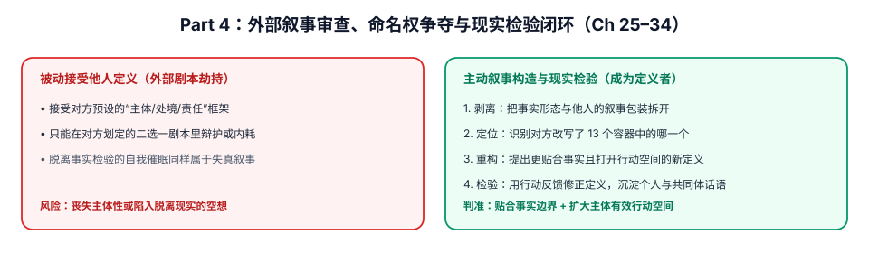

## 本章要解决的现实问题

你遇到一个全新的局面——信息不完整、各方说法不一、没有现成的词汇可用。真正的难点不是"没有定义"，而是在信息不足时过早锁定定义。

## 核心难点：信息不完整的留白策略

信息不足时，最容易犯的错误是：用最快的可用定义填满所有容器。这会产生看似完整但不准确的叙事。

正确的策略是：区分已知与未知，只在前端容器（事件材料）有足够信息时才生成解释和判断，其余标记为暂定或未知。

::: {.content-visible when-format="html"}

:::

## 操作方法

**第一步：区分已知与未知。** 列两栏：已确认的事实（可观察、可查证）和尚未确认的信息。标记每个未知项。

**第二步：识别关键容器。** 哪个容器对整个叙事影响最大但信息最不完整？把主要精力投在那个容器上。

**第三步：生成竞争定义。** 对关键容器生成至少两个候选定义，标注每个的证据强度。

**第四步：建立暂定框架。** 选择当前最有解释力的定义组合，标注"暂定"和修正条件。

**第五步：保持开放。** 标记哪些定义最可能被新事实改变，持续观察。

## 完整案例：B 收到 A 的消息（关系案例）

B 收到 A 的"聊清楚"消息时，信息极度不完整。

**已确认事实：** A 发了消息（已确认）、见面频率从每周3-4降为每周1（已确认）、A 之前两次提出沟通被 B 推迟（已确认）。

**未知信息：** A 为什么现在要聊（未知）、A 的具体感受（未知）、A 希望达到什么（未知）、A 对关系的定义（未知）。

**关键容器：** 当前意图容器最关键但信息最少。因此主要分析应放在意图容器，其他容器暂缓。

**竞争意图定义：**
- 候选 A：A 想修复关系（证据：主动联系、之前就提出过想聊。强度：暂定）
- 候选 B：A 准备结束关系（证据：见面频率下降后采取行动。强度：弱推断）
- 候选 C：A 想把情况说清楚（证据：文字中性。强度：暂定）

**暂定框架：** "A 想面对真实问题但不一定是结束。"修正条件：如果 A 安排具体见面时间并以中性语气开场，支持候选A或C。如果 A 在消息中已经带有决定性措辞，支持候选B。

## 本章产物

完整工作记录：已确认事实、未知清单、关键容器识别、竞争定义列表、暂定框架及修正条件。

::: {.content-visible when-format="html"}

:::

