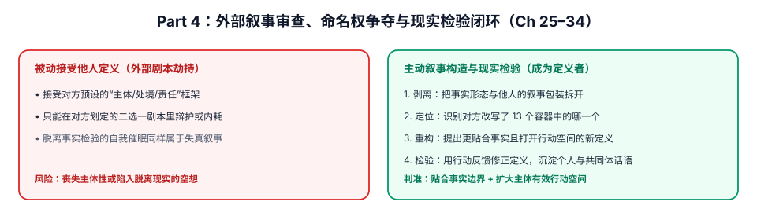

## 本章要解决的现实问题

别人——个人、媒体、组织——不断在构造关于你的叙事。真正的难点：**事实选择、容器遗漏、归因操纵和方向预设可以同时运作，让你在不察觉中接受一个对你不利的框架。**

## 四个识别层次

**1. 事实选择：** 叙事者呈现了哪些事实？遗漏了哪些？选择的偏向是什么？

**2. 容器遗漏：** 哪些容器被刻意回避？通常被回避的是原因和——暴露叙事者的弱点。

**3. 归因操纵：** 原因被导向了外部还是内部？动机被赋予了正面还是负面性质？

**4. 方向预设：** 叙事希望接受者采取什么行动？这个方向是否被包装成了自然结论？

::: {.content-visible when-format="html"}

:::

## 操作方法

用十三容器逐一审查外部叙事：

| 容器 | 问题 | 叙事定义 | 有/无 | 事实支撑 |
|------|------|----------|-------|----------|
| 主体 | 他把谁定义成什么？ | | | |
| 时间 | 是什么阶段？ | | | |
| 处境 | 什么局面？ | | | |
| 行为 | 什么行为性质？ | | | |
| 结果 | 什么结果？ | | | |
| 原因 | 原因归给谁？ | | | |
| 动机 | 动机是什么？ | | | |
| 意图 | 他认为行为者准备做什么？ | | | |
| 目标 | 他认为行为者想达成什么？ | | | |
| 责任 | 责任分配给谁？ | | | |
| 价值 | 采用什么标准？ | | | |
| 意义 | 希望事情代表什么？ | | | |
| 方向 | 希望接受者做什么？ | | | |

## 完整案例：临川市政府的公开声明

"临川市政府始终将人民生命安全放在第一位。灾后管制措施有效保障了重建秩序。个别不法分子借机制造混乱。广大市民应当支持政府工作，不信谣不传谣。"

**识别过程：**
- 主体定义：政府=保护者，抗议者=不法分子（明确）
- 行为定义：管制=保障秩序，抗议=制造混乱（明确）
- 动机定义：政府=人民安全，抗议者=制造混乱（明确）
- 原因：管制是灾后必要措施（有提及）
- 责任：未提及政府可能的管理问题（**缺失**）
- 时间：未说明管制何时结束——条件是什么（**缺失**）
- 方向：支持政府、不信谣不传谣（明确，被包装成自然结论）

## 本章产物

外部叙事审查表：完整十三容器扫描、缺失容器标记、事实选择评估、方向预设识别。

::: {.content-visible when-format="html"}

:::

