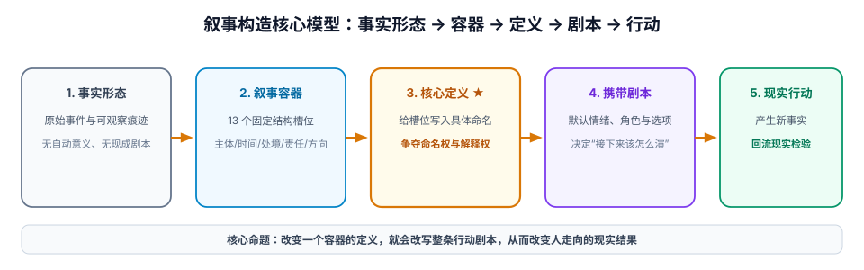

# Preface {.unnumbered}

这本书始于一个观察：人并不直接生活在事实中。

我们以为自己面对的是"事情本身"，但真正影响情绪、判断和行动的，往往是事情被定义之后的样子。

同样一次加班晚归，可以被定义为"不负责任"，也可以被定义为"为了共同的未来在努力"。同样一句批评，可以被定义为"人身攻击"，也可以被定义为"专业反馈"。事实没有变，定义变了，整个世界的面貌就变了。

这个观察本身并不新鲜。真正的问题在于：**如果定义如此重要，我们能否有意识地去理解它、审查它、甚至主动生成它？**

这就是这本书想要回答的问题。

它不追求告诉你"叙事很重要"——你大概已经知道了。它试图建立的是一套可操作的方法：如何识别一个事件中涉及哪些核心对象，如何判断一个定义是否准确，如何理解定义背后预设的剧本，以及——当现成的词汇不够用时——如何生成新的定义。

书中所有的方法都通过四个贯穿案例来展示：一个面临职业选择的年轻人、一段逐渐疏远的关系、一个陷入困境的项目、一座陷入争议的城市。它们覆盖了个人、关系、组织和公共四个层面，目的是让你看到，同样的工具在不同场景中如何工作。

这本书写了很久，改了很多版。最终呈现的版本，我希望它不只是"有道理"，而是"可以用"。

如果你读完任何一个章节后，能够对自己或身边的一件事做出更清晰的定义判断，这本书就没有白写。

Lin Mi 2026 年 7 月

